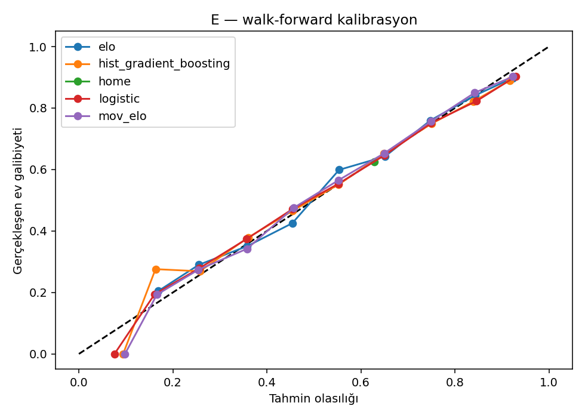
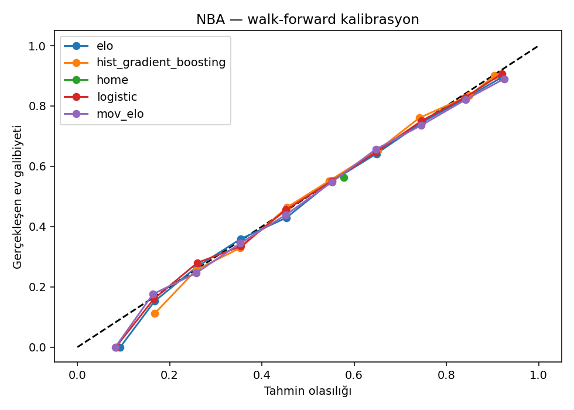
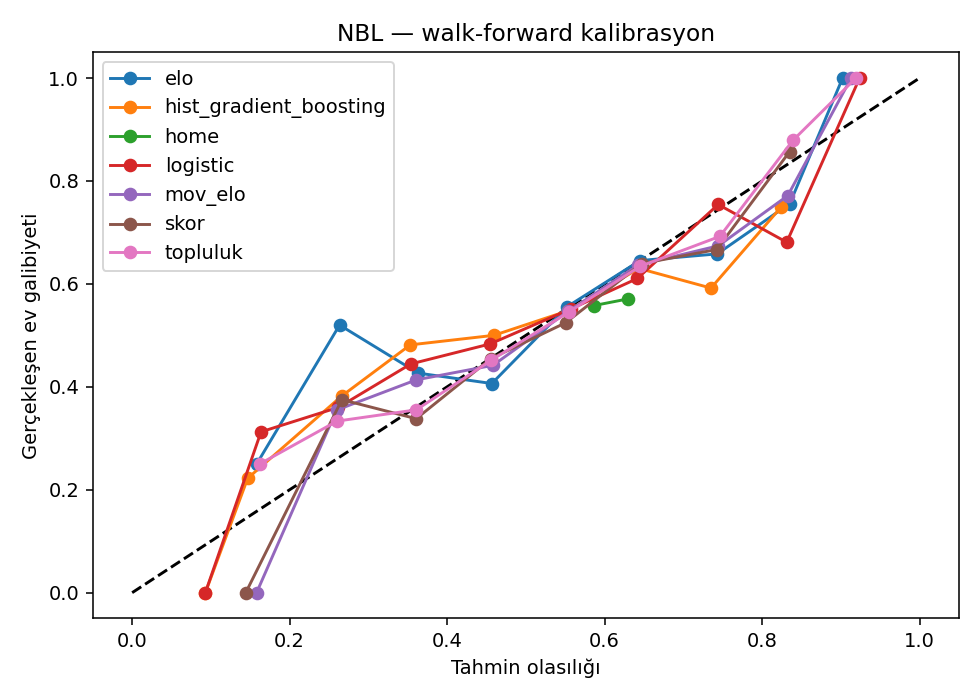
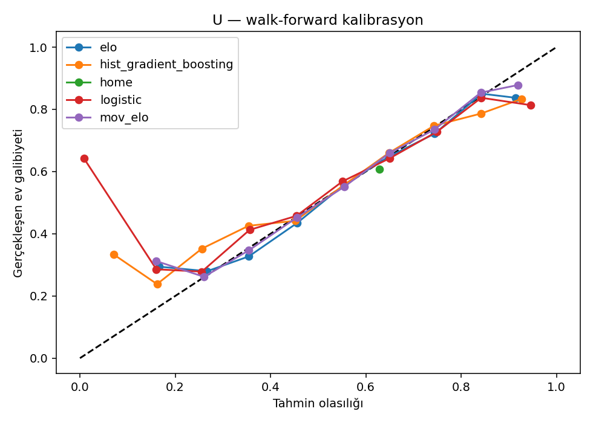

# Gerçek çalıştırma sonuçları

Rapor zamanı (UTC): 2026-10-22T06:45:41.984752+00:00. Toplama: 2026-10-22T06:41:56.963445+00:00.

Tam komutlar ve ortam: [README](../README.md) ve [ortam.txt](kanit/ortam.txt).

Çalıştırma (bu raporu üreten gerçek komutlar, proje kökünden):

```
python .runtime/run.py -m bbtahmin topla --ligler NBA --baslangic 2016 --bitis 2025
python .runtime/run.py -m bbtahmin backtest
python .runtime/run.py -m pytest -q -p no:cacheprovider tests --junitxml=docs/kanit/pytest.xml
python .runtime/run.py -m pytest -q -p no:cacheprovider tests/negative_control.py --junitxml=docs/kanit/negatif_kontrol.xml
# .runtime/run.py: sistem CPython 3.12.10 + .venv site-packages (eşdeğeri: .venv/Scripts/python.exe -m bbtahmin ...)
# E/U ve NBA 2014-15, 2015-16 ham yanıtları önceki koşudan önbellekte (data/raw); yeniden indirilmedi.
```

## Toplam değerlendirme

"home" = ev sahibi kazanır: her maçta ev sahibi seçilir, olasılık olarak eğitim penceresindeki ev galibiyet oranı verilir (doğruluk p=1 ile aynıdır; log loss sonsuza gitmez). Fark MAE için ev sahibi tabanı eğitim ortalama farkını, Elo tabanları eğitimde Elo farkından öğrenilen doğrusal regresyonu kullanır. Sınıflandırıcıların MAE değeri ortak Ridge regresyonunundur.

| lig | model | n | log_loss | brier | accuracy | margin_mae |
| --- | --- | --- | --- | --- | --- | --- |
| E | elo | 4681 | 0.6031 | 0.2080 | 0.6813 | 9.4043 |
| E | hist_gradient_boosting | 4681 | 0.6069 | 0.2094 | 0.6680 | 9.2624 |
| E | home | 4681 | 0.6623 | 0.2347 | 0.6240 | 10.1566 |
| E | logistic | 4681 | 0.5993 | 0.2065 | 0.6755 | 9.2624 |
| E | mov_elo | 4681 | 0.5980 | 0.2058 | 0.6764 | 9.3268 |
| E | skor | 4681 | 0.5955 | 0.2051 | 0.6768 | 9.2624 |
| E | topluluk | 4681 | 0.5958 | 0.2051 | 0.6776 | 9.2624 |
| NBA | elo | 12855 | 0.6291 | 0.2197 | 0.6461 | 10.8004 |
| NBA | hist_gradient_boosting | 12855 | 0.6228 | 0.2167 | 0.6530 | 10.5805 |
| NBA | home | 12855 | 0.6854 | 0.2461 | 0.5634 | 11.8200 |
| NBA | logistic | 12855 | 0.6185 | 0.2150 | 0.6535 | 10.5805 |
| NBA | mov_elo | 12855 | 0.6258 | 0.2180 | 0.6506 | 10.7234 |
| NBA | skor | 12855 | 0.6169 | 0.2143 | 0.6582 | 10.5805 |
| NBA | topluluk | 12855 | 0.6185 | 0.2149 | 0.6544 | 10.5805 |
| NBL | elo | 1418 | 0.6690 | 0.2377 | 0.6058 | 11.2562 |
| NBL | hist_gradient_boosting | 1418 | 0.6835 | 0.2448 | 0.5769 | 11.1598 |
| NBL | home | 1418 | 0.6887 | 0.2477 | 0.5642 | 11.6869 |
| NBL | logistic | 1418 | 0.6726 | 0.2396 | 0.5867 | 11.1598 |
| NBL | mov_elo | 1418 | 0.6619 | 0.2347 | 0.6079 | 11.1310 |
| NBL | skor | 1418 | 0.6615 | 0.2346 | 0.5987 | 11.1598 |
| NBL | topluluk | 1418 | 0.6619 | 0.2349 | 0.6037 | 11.1598 |
| U | elo | 3491 | 0.6245 | 0.2172 | 0.6557 | 10.0207 |
| U | hist_gradient_boosting | 3491 | 0.6325 | 0.2207 | 0.6451 | 9.8666 |
| U | home | 3491 | 0.6703 | 0.2387 | 0.6084 | 10.7496 |
| U | logistic | 3491 | 0.6667 | 0.2218 | 0.6571 | 9.8666 |
| U | mov_elo | 3491 | 0.6205 | 0.2155 | 0.6571 | 9.9491 |
| U | skor | 3491 | 0.6129 | 0.2121 | 0.6651 | 9.8666 |
| U | topluluk | 3491 | 0.6172 | 0.2141 | 0.6634 | 9.8666 |

## Lig ve sezon bazında yan yana

Hücre: log loss / Brier / doğruluk / fark MAE. Her ligin ilk iki mevcut sezonu yalnız eğitim ve kronolojik doğrulama içindir; test yapılmadı. BasketbolBet: **yapılamadı (referans bulunamadı)**. Kısmi toplanan sezonlar: yok.

### E

| sezon | elo | hist_gradient_boosting | home | logistic | mov_elo | skor | topluluk |
| --- | --- | --- | --- | --- | --- | --- | --- |
| 2009-10 | 0.5502 / 0.1855 / 0.7181 / 10.14 | 0.5523 / 0.1855 / 0.7181 / 9.40 | 0.6637 / 0.2354 / 0.6223 / 10.78 | 0.5427 / 0.1855 / 0.7074 / 9.40 | 0.5364 / 0.1798 / 0.7287 / 10.07 | 0.5326 / 0.1812 / 0.7234 / 9.40 | 0.5342 / 0.1809 / 0.7287 / 9.40 |
| 2010-11 | 0.6148 / 0.2111 / 0.6878 / 10.09 | 0.6197 / 0.2139 / 0.6720 / 9.79 | 0.6504 / 0.2289 / 0.6455 / 10.62 | 0.6138 / 0.2104 / 0.6772 / 9.79 | 0.6097 / 0.2080 / 0.6720 / 10.05 | 0.6131 / 0.2109 / 0.6667 / 9.79 | 0.6094 / 0.2085 / 0.6772 / 9.79 |
| 2011-12 | 0.5576 / 0.1875 / 0.7447 / 9.01 | 0.5732 / 0.1941 / 0.7181 / 9.04 | 0.6634 / 0.2353 / 0.6223 / 10.90 | 0.5556 / 0.1874 / 0.7181 / 9.04 | 0.5515 / 0.1850 / 0.7234 / 9.00 | 0.5411 / 0.1820 / 0.7287 / 9.04 | 0.5466 / 0.1835 / 0.7181 / 9.04 |
| 2012-13 | 0.5642 / 0.1910 / 0.7154 / 9.64 | 0.5717 / 0.1942 / 0.6996 / 9.27 | 0.6774 / 0.2421 / 0.5968 / 10.81 | 0.5594 / 0.1896 / 0.6838 / 9.27 | 0.5599 / 0.1894 / 0.6957 / 9.44 | 0.5589 / 0.1894 / 0.6759 / 9.27 | 0.5577 / 0.1888 / 0.6838 / 9.27 |
| 2013-14 | 0.5567 / 0.1870 / 0.7352 / 9.42 | 0.5757 / 0.1957 / 0.6917 / 9.40 | 0.6577 / 0.2325 / 0.6324 / 10.95 | 0.5516 / 0.1856 / 0.7233 / 9.40 | 0.5491 / 0.1839 / 0.7312 / 9.37 | 0.5534 / 0.1866 / 0.7273 / 9.40 | 0.5495 / 0.1846 / 0.7194 / 9.40 |
| 2014-15 | 0.5330 / 0.1779 / 0.7610 / 8.40 | 0.5520 / 0.1853 / 0.7331 / 8.35 | 0.6613 / 0.2343 / 0.6255 / 9.99 | 0.5412 / 0.1809 / 0.7331 / 8.35 | 0.5289 / 0.1756 / 0.7570 / 8.17 | 0.5483 / 0.1834 / 0.7530 / 8.35 | 0.5383 / 0.1794 / 0.7450 / 8.35 |
| 2015-16 | 0.6066 / 0.2084 / 0.6880 / 10.40 | 0.6100 / 0.2089 / 0.6880 / 10.03 | 0.6516 / 0.2295 / 0.6440 / 10.99 | 0.5936 / 0.2033 / 0.6800 / 10.03 | 0.5940 / 0.2044 / 0.6920 / 10.22 | 0.5835 / 0.1994 / 0.6880 / 10.03 | 0.5884 / 0.2017 / 0.6880 / 10.03 |
| 2016-17 | 0.6163 / 0.2140 / 0.6448 / 8.85 | 0.6101 / 0.2122 / 0.6486 / 8.91 | 0.6634 / 0.2353 / 0.6216 / 9.21 | 0.6147 / 0.2139 / 0.6409 / 8.91 | 0.6125 / 0.2125 / 0.6409 / 8.81 | 0.6128 / 0.2135 / 0.6525 / 8.91 | 0.6123 / 0.2129 / 0.6602 / 8.91 |
| 2017-18 | 0.6065 / 0.2095 / 0.6692 / 9.31 | 0.6225 / 0.2156 / 0.6423 / 9.30 | 0.6565 / 0.2319 / 0.6346 / 9.73 | 0.6119 / 0.2115 / 0.6731 / 9.30 | 0.6063 / 0.2093 / 0.6769 / 9.17 | 0.6167 / 0.2131 / 0.6769 / 9.30 | 0.6102 / 0.2108 / 0.6731 / 9.30 |
| 2018-19 | 0.5795 / 0.1972 / 0.7077 / 9.14 | 0.5701 / 0.1938 / 0.6885 / 8.87 | 0.6606 / 0.2339 / 0.6269 / 10.40 | 0.5650 / 0.1915 / 0.6962 / 8.87 | 0.5715 / 0.1941 / 0.6962 / 9.00 | 0.5542 / 0.1873 / 0.7192 / 8.87 | 0.5624 / 0.1904 / 0.7000 / 8.87 |
| 2019-20 | 0.6032 / 0.2090 / 0.6627 / 9.60 | 0.5785 / 0.1982 / 0.6786 / 9.36 | 0.6648 / 0.2359 / 0.6190 / 10.15 | 0.5837 / 0.2008 / 0.6746 / 9.36 | 0.5865 / 0.2021 / 0.6786 / 9.38 | 0.5829 / 0.2000 / 0.6746 / 9.36 | 0.5826 / 0.2002 / 0.6786 / 9.36 |
| 2020-21 | 0.6621 / 0.2327 / 0.6341 / 9.83 | 0.6793 / 0.2382 / 0.6311 / 9.84 | 0.6920 / 0.2493 / 0.5671 / 10.61 | 0.6671 / 0.2329 / 0.6524 / 9.84 | 0.6611 / 0.2319 / 0.6463 / 9.90 | 0.6574 / 0.2304 / 0.6463 / 9.84 | 0.6593 / 0.2309 / 0.6494 / 9.84 |
| 2021-22 | 0.6328 / 0.2211 / 0.6388 / 9.93 | 0.6315 / 0.2208 / 0.6455 / 9.68 | 0.6497 / 0.2285 / 0.6488 / 9.99 | 0.6213 / 0.2160 / 0.6689 / 9.68 | 0.6250 / 0.2175 / 0.6522 / 9.73 | 0.6058 / 0.2101 / 0.6622 / 9.68 | 0.6151 / 0.2134 / 0.6488 / 9.68 |
| 2022-23 | 0.6312 / 0.2204 / 0.6677 / 9.17 | 0.6351 / 0.2217 / 0.6463 / 9.13 | 0.6616 / 0.2344 / 0.6250 / 9.67 | 0.6281 / 0.2191 / 0.6524 / 9.13 | 0.6272 / 0.2189 / 0.6402 / 9.14 | 0.6291 / 0.2198 / 0.6159 / 9.13 | 0.6263 / 0.2185 / 0.6463 / 9.13 |
| 2023-24 | 0.5932 / 0.2033 / 0.7160 / 9.15 | 0.5944 / 0.2037 / 0.7160 / 8.96 | 0.6506 / 0.2290 / 0.6465 / 9.66 | 0.5901 / 0.2022 / 0.7100 / 8.96 | 0.5957 / 0.2042 / 0.6949 / 9.16 | 0.5861 / 0.2010 / 0.7069 / 8.96 | 0.5888 / 0.2015 / 0.7190 / 8.96 |
| 2024-25 | 0.6265 / 0.2200 / 0.6303 / 9.21 | 0.6250 / 0.2188 / 0.6303 / 9.12 | 0.6651 / 0.2361 / 0.6182 / 9.79 | 0.6210 / 0.2173 / 0.6394 / 9.12 | 0.6208 / 0.2176 / 0.6333 / 9.15 | 0.6169 / 0.2156 / 0.6485 / 9.12 | 0.6186 / 0.2164 / 0.6364 / 9.12 |
| 2025-26 | 0.6284 / 0.2197 / 0.6617 / 9.15 | 0.6319 / 0.2213 / 0.6095 / 9.22 | 0.6555 / 0.2314 / 0.6368 / 9.57 | 0.6338 / 0.2220 / 0.6318 / 9.22 | 0.6300 / 0.2203 / 0.6418 / 9.23 | 0.6349 / 0.2227 / 0.6269 / 9.22 | 0.6321 / 0.2214 / 0.6343 / 9.22 |
| 2026-27 | 0.6717 / 0.2407 / 0.5500 / 8.80 | 0.6712 / 0.2395 / 0.5833 / 8.74 | 0.7090 / 0.2576 / 0.5333 / 10.10 | 0.6580 / 0.2337 / 0.6000 / 8.74 | 0.6682 / 0.2387 / 0.5667 / 8.77 | 0.6471 / 0.2275 / 0.6500 / 8.74 | 0.6549 / 0.2323 / 0.6167 / 8.74 |

### NBA

| sezon | elo | hist_gradient_boosting | home | logistic | mov_elo | skor | topluluk |
| --- | --- | --- | --- | --- | --- | --- | --- |
| 2016-17 | 0.6278 / 0.2194 / 0.6417 / 10.09 | 0.6265 / 0.2186 / 0.6562 / 10.01 | 0.6794 / 0.2431 / 0.5829 / 11.12 | 0.6215 / 0.2164 / 0.6494 / 10.01 | 0.6306 / 0.2198 / 0.6486 / 10.11 | 0.6191 / 0.2154 / 0.6524 / 10.01 | 0.6215 / 0.2164 / 0.6463 / 10.01 |
| 2017-18 | 0.6286 / 0.2191 / 0.6441 / 10.17 | 0.6221 / 0.2162 / 0.6479 / 9.89 | 0.6780 / 0.2425 / 0.5869 / 10.86 | 0.6155 / 0.2135 / 0.6562 / 9.89 | 0.6198 / 0.2153 / 0.6578 / 9.98 | 0.6133 / 0.2127 / 0.6623 / 9.89 | 0.6148 / 0.2131 / 0.6547 / 9.89 |
| 2018-19 | 0.6219 / 0.2163 / 0.6639 / 10.39 | 0.6144 / 0.2131 / 0.6585 / 10.19 | 0.6767 / 0.2418 / 0.5907 / 11.39 | 0.6116 / 0.2117 / 0.6608 / 10.19 | 0.6180 / 0.2146 / 0.6524 / 10.30 | 0.6114 / 0.2116 / 0.6608 / 10.19 | 0.6125 / 0.2121 / 0.6593 / 10.19 |
| 2019-20 | 0.6326 / 0.2212 / 0.6535 / 10.26 | 0.6349 / 0.2219 / 0.6457 / 10.20 | 0.6919 / 0.2494 / 0.5468 / 11.27 | 0.6312 / 0.2207 / 0.6500 / 10.20 | 0.6329 / 0.2216 / 0.6422 / 10.29 | 0.6264 / 0.2187 / 0.6500 / 10.20 | 0.6281 / 0.2194 / 0.6553 / 10.20 |
| 2020-21 | 0.6467 / 0.2279 / 0.6072 / 11.37 | 0.6402 / 0.2246 / 0.6311 / 11.12 | 0.6911 / 0.2490 / 0.5465 / 12.07 | 0.6372 / 0.2234 / 0.6225 / 11.12 | 0.6450 / 0.2268 / 0.6243 / 11.30 | 0.6360 / 0.2230 / 0.6243 / 11.12 | 0.6377 / 0.2237 / 0.6251 / 11.12 |
| 2021-22 | 0.6380 / 0.2233 / 0.6485 / 11.28 | 0.6292 / 0.2192 / 0.6553 / 11.04 | 0.6901 / 0.2485 / 0.5480 / 12.23 | 0.6223 / 0.2164 / 0.6621 / 11.04 | 0.6340 / 0.2213 / 0.6591 / 11.21 | 0.6219 / 0.2162 / 0.6682 / 11.04 | 0.6243 / 0.2172 / 0.6652 / 11.04 |
| 2022-23 | 0.6487 / 0.2284 / 0.6303 / 10.24 | 0.6481 / 0.2284 / 0.6212 / 10.16 | 0.6801 / 0.2435 / 0.5811 / 10.91 | 0.6456 / 0.2271 / 0.6205 / 10.16 | 0.6482 / 0.2281 / 0.6288 / 10.24 | 0.6432 / 0.2260 / 0.6379 / 10.16 | 0.6435 / 0.2261 / 0.6348 / 10.16 |
| 2023-24 | 0.6222 / 0.2167 / 0.6406 / 11.30 | 0.6171 / 0.2141 / 0.6543 / 10.96 | 0.6900 / 0.2484 / 0.5474 / 12.48 | 0.6079 / 0.2104 / 0.6573 / 10.96 | 0.6195 / 0.2154 / 0.6444 / 11.16 | 0.6029 / 0.2084 / 0.6657 / 10.96 | 0.6081 / 0.2104 / 0.6558 / 10.96 |
| 2024-25 | 0.6174 / 0.2148 / 0.6571 / 11.27 | 0.6063 / 0.2096 / 0.6752 / 10.99 | 0.6904 / 0.2486 / 0.5450 / 12.67 | 0.6035 / 0.2084 / 0.6692 / 10.99 | 0.6130 / 0.2128 / 0.6563 / 11.18 | 0.6044 / 0.2086 / 0.6699 / 10.99 | 0.6045 / 0.2089 / 0.6677 / 10.99 |
| 2025-26 | 0.6089 / 0.2103 / 0.6710 / 11.61 | 0.5924 / 0.2029 / 0.6815 / 11.24 | 0.6874 / 0.2471 / 0.5552 / 13.15 | 0.5912 / 0.2028 / 0.6838 / 11.24 | 0.5993 / 0.2060 / 0.6891 / 11.47 | 0.5927 / 0.2033 / 0.6861 / 11.24 | 0.5924 / 0.2031 / 0.6770 / 11.24 |
| 2026-27 | 0.8797 / 0.3357 / 0.3333 / 10.73 | 0.9807 / 0.3820 / 0.3333 / 12.46 | 0.7472 / 0.2769 / 0.3333 / 9.43 | 1.0432 / 0.4005 / 0.3333 / 12.46 | 0.9635 / 0.3718 / 0.3333 / 11.53 | 0.9686 / 0.3745 / 0.3333 / 12.46 | 0.9900 / 0.3820 / 0.3333 / 12.46 |

### NBL

| sezon | elo | hist_gradient_boosting | home | logistic | mov_elo | skor | topluluk |
| --- | --- | --- | --- | --- | --- | --- | --- |
| 2017-18 | 0.6521 / 0.2296 / 0.6471 / 10.67 | 0.7261 / 0.2635 / 0.5966 / 10.73 | 0.6764 / 0.2415 / 0.6050 / 11.01 | 0.6691 / 0.2381 / 0.6050 / 10.73 | 0.6555 / 0.2312 / 0.6639 / 10.72 | 0.6592 / 0.2328 / 0.6134 / 10.73 | 0.6572 / 0.2322 / 0.6134 / 10.73 |
| 2018-19 | 0.6797 / 0.2411 / 0.6083 / 10.83 | 0.6732 / 0.2403 / 0.5500 / 10.39 | 0.6904 / 0.2484 / 0.5750 / 10.69 | 0.6579 / 0.2328 / 0.5917 / 10.39 | 0.6714 / 0.2377 / 0.5833 / 10.61 | 0.6581 / 0.2329 / 0.5750 / 10.39 | 0.6568 / 0.2322 / 0.6000 / 10.39 |
| 2019-20 | 0.6276 / 0.2182 / 0.6716 / 10.07 | 0.6618 / 0.2344 / 0.6269 / 10.37 | 0.6532 / 0.2303 / 0.6418 / 10.54 | 0.6615 / 0.2353 / 0.5896 / 10.37 | 0.6220 / 0.2157 / 0.6940 / 9.98 | 0.6371 / 0.2231 / 0.6418 / 10.37 | 0.6364 / 0.2228 / 0.6343 / 10.37 |
| 2020-21 | 0.6612 / 0.2349 / 0.6023 / 10.05 | 0.6975 / 0.2508 / 0.5556 / 10.20 | 0.6945 / 0.2505 / 0.5614 / 10.79 | 0.6899 / 0.2461 / 0.5848 / 10.20 | 0.6704 / 0.2378 / 0.6082 / 10.17 | 0.6618 / 0.2350 / 0.5965 / 10.20 | 0.6704 / 0.2383 / 0.5789 / 10.20 |
| 2021-22 | 0.6500 / 0.2290 / 0.6014 / 9.98 | 0.6845 / 0.2456 / 0.5608 / 10.11 | 0.7252 / 0.2657 / 0.4865 / 11.14 | 0.6491 / 0.2290 / 0.6351 / 10.11 | 0.6511 / 0.2297 / 0.6216 / 10.03 | 0.6658 / 0.2369 / 0.5811 / 10.11 | 0.6526 / 0.2306 / 0.6216 / 10.11 |
| 2022-23 | 0.7176 / 0.2594 / 0.5724 / 12.11 | 0.6994 / 0.2529 / 0.5395 / 11.97 | 0.6908 / 0.2488 / 0.5526 / 11.99 | 0.7122 / 0.2585 / 0.5329 / 11.97 | 0.6756 / 0.2423 / 0.5724 / 11.87 | 0.6855 / 0.2454 / 0.5724 / 11.97 | 0.6844 / 0.2458 / 0.5921 / 11.97 |
| 2023-24 | 0.6781 / 0.2425 / 0.5896 / 11.66 | 0.6746 / 0.2408 / 0.5896 / 11.65 | 0.6770 / 0.2420 / 0.5896 / 11.79 | 0.6761 / 0.2416 / 0.5896 / 11.65 | 0.6856 / 0.2462 / 0.5549 / 11.65 | 0.6767 / 0.2420 / 0.5896 / 11.65 | 0.6777 / 0.2425 / 0.5954 / 11.65 |
| 2024-25 | 0.6747 / 0.2406 / 0.5872 / 12.20 | 0.6680 / 0.2375 / 0.5814 / 12.10 | 0.6901 / 0.2485 / 0.5523 / 12.40 | 0.6771 / 0.2418 / 0.5640 / 12.10 | 0.6693 / 0.2378 / 0.6047 / 12.04 | 0.6740 / 0.2394 / 0.6279 / 12.10 | 0.6716 / 0.2389 / 0.5930 / 12.10 |
| 2025-26 | 0.6489 / 0.2286 / 0.6369 / 12.91 | 0.6470 / 0.2277 / 0.6257 / 12.00 | 0.6968 / 0.2518 / 0.5307 / 13.98 | 0.6112 / 0.2118 / 0.6313 / 12.00 | 0.6140 / 0.2137 / 0.6369 / 12.21 | 0.6087 / 0.2107 / 0.6257 / 12.00 | 0.6104 / 0.2117 / 0.6536 / 12.00 |
| 2026-27 | 0.7509 / 0.2775 / 0.4600 / 11.65 | 0.7793 / 0.2904 / 0.4600 / 12.12 | 0.6803 / 0.2436 / 0.5800 / 11.50 | 0.8291 / 0.3073 / 0.4600 / 12.12 | 0.7862 / 0.2935 / 0.4600 / 11.93 | 0.7481 / 0.2771 / 0.4800 / 12.12 | 0.7795 / 0.2907 / 0.4600 / 12.12 |

### U

| sezon | elo | hist_gradient_boosting | home | logistic | mov_elo | skor | topluluk |
| --- | --- | --- | --- | --- | --- | --- | --- |
| 2009-10 | 0.6559 / 0.2311 / 0.6346 / 10.87 | 0.6620 / 0.2340 / 0.6026 / 10.44 | 0.6658 / 0.2363 / 0.6218 / 10.30 | 0.6456 / 0.2268 / 0.6474 / 10.44 | 0.6620 / 0.2336 / 0.6346 / 11.39 | 0.6503 / 0.2285 / 0.6538 / 10.44 | 0.6482 / 0.2279 / 0.6603 / 10.44 |
| 2010-11 | 0.6423 / 0.2260 / 0.6258 / 9.22 | 0.6643 / 0.2359 / 0.6000 / 9.33 | 0.6740 / 0.2404 / 0.6065 / 9.83 | 0.6403 / 0.2253 / 0.6065 / 9.33 | 0.6375 / 0.2237 / 0.6258 / 9.12 | 0.6497 / 0.2293 / 0.5871 / 9.33 | 0.6397 / 0.2250 / 0.6194 / 9.33 |
| 2011-12 | 0.5699 / 0.1939 / 0.6987 / 9.12 | 0.6166 / 0.2135 / 0.6474 / 9.18 | 0.6492 / 0.2283 / 0.6474 / 10.57 | 0.5649 / 0.1911 / 0.7372 / 9.18 | 0.5646 / 0.1917 / 0.7115 / 9.02 | 0.5520 / 0.1870 / 0.7308 / 9.18 | 0.5576 / 0.1883 / 0.7308 / 9.18 |
| 2012-13 | 0.6207 / 0.2159 / 0.6624 / 10.26 | 0.6500 / 0.2286 / 0.6306 / 10.64 | 0.6957 / 0.2510 / 0.5669 / 11.43 | 0.6549 / 0.2311 / 0.6115 / 10.64 | 0.6168 / 0.2143 / 0.6561 / 10.33 | 0.6386 / 0.2260 / 0.6115 / 10.64 | 0.6302 / 0.2215 / 0.6306 / 10.64 |
| 2013-14 | 0.6124 / 0.2120 / 0.6913 / 9.61 | 0.6299 / 0.2199 / 0.6475 / 9.69 | 0.6481 / 0.2278 / 0.6503 / 10.68 | 1.0093 / 0.2540 / 0.6475 / 9.69 | 0.6139 / 0.2126 / 0.6639 / 9.51 | 0.6050 / 0.2086 / 0.6885 / 9.69 | 0.6238 / 0.2175 / 0.6612 / 9.69 |
| 2014-15 | 0.6040 / 0.2087 / 0.6754 / 9.73 | 0.6336 / 0.2218 / 0.6328 / 9.68 | 0.6757 / 0.2412 / 0.6000 / 10.44 | 0.6697 / 0.2385 / 0.6000 / 9.68 | 0.6067 / 0.2096 / 0.6885 / 9.79 | 0.6068 / 0.2086 / 0.6820 / 9.68 | 0.6132 / 0.2123 / 0.6623 / 9.68 |
| 2015-16 | 0.6546 / 0.2285 / 0.6316 / 10.12 | 0.6604 / 0.2311 / 0.6250 / 9.89 | 0.6773 / 0.2420 / 0.5954 / 10.59 | 0.6487 / 0.2274 / 0.6447 / 9.89 | 0.6449 / 0.2255 / 0.6283 / 9.90 | 0.6489 / 0.2276 / 0.6480 / 9.89 | 0.6459 / 0.2261 / 0.6480 / 9.89 |
| 2016-17 | 0.6138 / 0.2122 / 0.6849 / 10.76 | 0.5953 / 0.2039 / 0.6918 / 10.28 | 0.6624 / 0.2348 / 0.6233 / 11.01 | 0.5940 / 0.2029 / 0.7123 / 10.28 | 0.6083 / 0.2098 / 0.6781 / 10.73 | 0.5843 / 0.1981 / 0.7055 / 10.28 | 0.5916 / 0.2022 / 0.7123 / 10.28 |
| 2017-18 | 0.6178 / 0.2151 / 0.6630 / 9.58 | 0.6301 / 0.2209 / 0.6467 / 9.46 | 0.6753 / 0.2411 / 0.5978 / 10.55 | 0.6097 / 0.2115 / 0.6685 / 9.46 | 0.6166 / 0.2146 / 0.6685 / 9.48 | 0.6071 / 0.2102 / 0.6576 / 9.46 | 0.6095 / 0.2115 / 0.6685 / 9.46 |
| 2018-19 | 0.5764 / 0.1966 / 0.6935 / 8.64 | 0.5576 / 0.1888 / 0.7151 / 8.33 | 0.6649 / 0.2360 / 0.6183 / 9.82 | 0.5373 / 0.1800 / 0.7312 / 8.33 | 0.5808 / 0.1968 / 0.6989 / 8.50 | 0.5434 / 0.1820 / 0.7151 / 8.33 | 0.5508 / 0.1846 / 0.7204 / 8.33 |
| 2019-20 | 0.6869 / 0.2426 / 0.5952 / 10.23 | 0.7037 / 0.2494 / 0.6012 / 9.72 | 0.6557 / 0.2315 / 0.6369 / 9.74 | 0.7032 / 0.2457 / 0.6369 / 9.72 | 0.6859 / 0.2419 / 0.6071 / 10.10 | 0.6739 / 0.2366 / 0.6071 / 9.72 | 0.6839 / 0.2402 / 0.6250 / 9.72 |
| 2020-21 | 0.6462 / 0.2275 / 0.6000 / 9.83 | 0.6348 / 0.2225 / 0.6054 / 9.68 | 0.6822 / 0.2445 / 0.5838 / 10.47 | 0.6207 / 0.2157 / 0.6541 / 9.68 | 0.6337 / 0.2217 / 0.6216 / 9.75 | 0.5999 / 0.2057 / 0.6865 / 9.68 | 0.6154 / 0.2131 / 0.6595 / 9.68 |
| 2021-22 | 0.6227 / 0.2165 / 0.6508 / 10.47 | 0.6190 / 0.2172 / 0.6349 / 10.11 | 0.6645 / 0.2358 / 0.6190 / 11.18 | 0.6293 / 0.2208 / 0.6508 / 10.11 | 0.6196 / 0.2165 / 0.6508 / 10.28 | 0.6042 / 0.2102 / 0.6455 / 10.11 | 0.6128 / 0.2139 / 0.6508 / 10.11 |
| 2022-23 | 0.5893 / 0.2032 / 0.6615 / 9.26 | 0.5987 / 0.2075 / 0.6564 / 9.53 | 0.6638 / 0.2355 / 0.6205 / 10.34 | 0.6030 / 0.2097 / 0.6410 / 9.53 | 0.5952 / 0.2064 / 0.6564 / 9.51 | 0.5955 / 0.2069 / 0.6462 / 9.53 | 0.5968 / 0.2071 / 0.6308 / 9.53 |
| 2023-24 | 0.6355 / 0.2211 / 0.6718 / 10.59 | 0.6054 / 0.2073 / 0.6821 / 9.99 | 0.7066 / 0.2564 / 0.5333 / 11.71 | 0.5955 / 0.2032 / 0.6974 / 9.99 | 0.6200 / 0.2143 / 0.6564 / 10.29 | 0.6009 / 0.2055 / 0.6974 / 9.99 | 0.6032 / 0.2067 / 0.6872 / 9.99 |
| 2024-25 | 0.6262 / 0.2179 / 0.6480 / 10.41 | 0.6453 / 0.2254 / 0.6735 / 10.06 | 0.6726 / 0.2398 / 0.6020 / 11.19 | 0.6340 / 0.2202 / 0.6786 / 10.06 | 0.6152 / 0.2129 / 0.6633 / 10.18 | 0.6141 / 0.2118 / 0.6582 / 10.06 | 0.6173 / 0.2134 / 0.6531 / 10.06 |
| 2025-26 | 0.6303 / 0.2197 / 0.6462 / 11.87 | 0.6270 / 0.2178 / 0.6667 / 11.52 | 0.6807 / 0.2437 / 0.5846 / 12.91 | 0.6221 / 0.2148 / 0.6615 / 11.52 | 0.6139 / 0.2121 / 0.6718 / 11.54 | 0.6204 / 0.2141 / 0.6718 / 11.52 | 0.6157 / 0.2126 / 0.6872 / 11.52 |
| 2026-27 | 0.6934 / 0.2469 / 0.5849 / 11.02 | 0.6857 / 0.2409 / 0.6792 / 11.53 | 0.6369 / 0.2222 / 0.6792 / 10.74 | 0.6746 / 0.2381 / 0.6604 / 11.53 | 0.6818 / 0.2427 / 0.5849 / 11.16 | 0.6859 / 0.2429 / 0.6038 / 11.53 | 0.6792 / 0.2406 / 0.6226 / 11.53 |

## Toplanan maç sayıları

| lig | sezon | mac_sayisi | durum |
| --- | --- | --- | --- |
| E | 2007-08 | 231 | alındı |
| E | 2008-09 | 188 | alındı |
| E | 2009-10 | 188 | alındı |
| E | 2010-11 | 189 | alındı |
| E | 2011-12 | 188 | alındı |
| E | 2012-13 | 253 | alındı |
| E | 2013-14 | 253 | alındı |
| E | 2014-15 | 251 | alındı |
| E | 2015-16 | 250 | alındı |
| E | 2016-17 | 259 | alındı |
| E | 2017-18 | 260 | alındı |
| E | 2018-19 | 260 | alındı |
| E | 2019-20 | 252 | alındı |
| E | 2020-21 | 328 | alındı |
| E | 2021-22 | 299 | alındı |
| E | 2022-23 | 328 | alındı |
| E | 2023-24 | 331 | alındı |
| E | 2024-25 | 330 | alındı |
| E | 2025-26 | 402 | alındı |
| U | 2007-08 | 323 | alındı |
| U | 2008-09 | 151 | alındı |
| U | 2009-10 | 156 | alındı |
| U | 2010-11 | 155 | alındı |
| U | 2011-12 | 156 | alındı |
| U | 2012-13 | 157 | alındı |
| U | 2013-14 | 366 | alındı |
| U | 2014-15 | 305 | alındı |
| U | 2015-16 | 304 | alındı |
| U | 2016-17 | 146 | alındı |
| U | 2017-18 | 184 | alındı |
| U | 2018-19 | 186 | alındı |
| U | 2019-20 | 168 | alındı |
| U | 2020-21 | 185 | alındı |
| U | 2021-22 | 189 | alındı |
| U | 2022-23 | 195 | alındı |
| U | 2023-24 | 195 | alındı |
| U | 2024-25 | 196 | alındı |
| U | 2025-26 | 195 | alındı |
| NBA | 2014-15 | 1311 | alındı |
| NBA | 2015-16 | 1316 | alındı |
| NBA | 2016-17 | 1309 | alındı |
| NBA | 2017-18 | 1312 | alındı |
| NBA | 2018-19 | 1312 | alındı |
| NBA | 2019-20 | 1143 | alındı |
| NBA | 2020-21 | 1171 | alındı |
| NBA | 2021-22 | 1323 | alındı |
| NBA | 2022-23 | 1320 | alındı |
| NBA | 2023-24 | 1319 | alındı |
| NBA | 2024-25 | 1321 | alındı |
| NBA | 2025-26 | 1322 | alındı |
| E | 2026-27 | 60 | alındı |
| U | 2026-27 | 53 | alındı |
| NBA | 2026-27 | 3 | alındı |
| NBL | 2025-26 | 179 | alındı |
| NBL | 2023-24 | 173 | alındı |
| NBL | 2024-25 | 172 | alındı |
| NBL | 2020-21 | 171 | alındı |
| NBL | 2022-23 | 152 | alındı |
| NBL | 2021-22 | 148 | alındı |
| NBL | 2019-20 | 134 | alındı |
| NBL | 2018-19 | 120 | alındı |
| NBL | 2017-18 | 119 | alındı |
| NBL | 2015-16 | 118 | alındı |
| NBL | 2016-17 | 117 | alındı |
| NBL | 2026-27 | 50 | alındı |

Oynanmayan maçlar alınmadı. EuroCup iki ayaklı eşleşme beraberlikleri dışlandı; adetler toplama.json / excluded_ties alanında. Pandemi sezonları eksik kalmıştır.

## Kaynak erişimi ve oranlar

Skor kaynaklarında raporlanan hata yok.

Oran sezonları ve kaynak mesajları:

| sezon | status | error |
| --- | --- | --- |
| 2026-27 | atlandı | SBR kullanım şartları yazılı izin gerektiriyor (https://www.sportsbookreviewsonline.com/terms/); --sbr-izni verilmedi |

## NBA piyasa kıyası ve bahis simülasyonu

**Yapılmadı.** NBA piyasa kıyası, eğitimde avantaj eşiği seçimi, ROI / en büyük düşüş / bahis sayısı hesaplanmadı: kapanış oranı kullanılmadı. Sportsbook Reviews Online arşivi robots.txt ile izinli ve 2014-15…2022-23 sayfaları oran tablosu içeriyor; ancak sitenin Terms sayfası "içerik yazılı izin olmadan kullanılamaz veya çoğaltılamaz" diyor. Görev kullanım şartlarına uymayı istediği için oranlar ayrıştırılmadı. İzin alındığında `python -m bbtahmin topla --ligler NBA --baslangic 2014 --sbr-izni` ve ardından `backtest` ile bu bölüm otomatik dolar (ayrıştırıcı, eşleştirme, vig çıkarma ve eşik seçimi fixture testleriyle doğrulandı).

Eşleşmeyen oran satırı sayısı: **hesaplanmadı (oran satırı ayrıştırılmadı)**. Açık franchise eşlemesi src/bbtahmin/veri/teams.py içinde.

## Yöntem ve belirsizlik

Sezon başlangıcında yeniden eğitim; test sırasında yalnız önceki günlerin özellik durumu güncellenir. Son eğitim sezonu doğrulama, daha eski sezonlar iç eğitimdir. Elo K, ev avantajı, sezon çekmesi, EWMA, lojistik C, boosting yaprak sayısı ve Ridge alpha yalnız bu eğitim penceresinde ızgara ile seçilir. Platt kalibrasyonu önceki sezonda, o sezonu görmeyen model tahminlerinden öğrenilir. Aynı UTC gününün sonuçları birlikte geciktirilir. Izgaralar önceden tanımlıdır; geniş kapsamlı hiperparametre optimizasyonu yapılmadı.

Model − Elo log loss farkı: negatif daha iyi. Sezonlara eşit ağırlık; 10.000 sezon bootstrap örneğiyle %95 aralık ve 10.000 işaret permütasyonuyla iki yönlü p. Karşılaştırmalara lig içinde Holm düzeltmesi. Az sezon ve sezonlar arası bağımlılık nedeniyle sonuç keşifseldir; p<0,05 olmadan üstünlük iddiası yok. İkiden az test sezonu olan ligde anlamlılık hesabı yapılmaz.

| lig | model | seasons | mean_season_logloss_delta | ci_low | ci_high | p | p_holm |
| --- | --- | --- | --- | --- | --- | --- | --- |
| E | logistic | 18 | -0.0045 | -0.0080 | -0.0011 | 0.0243 | 0.0486 |
| E | hist_gradient_boosting | 18 | 0.0039 | -0.0014 | 0.0087 | 0.1558 | 0.1558 |
| E | mov_elo | 18 | -0.0056 | -0.0079 | -0.0034 | 0.0003 | 0.0009 |
| NBA | logistic | 11 | 0.0053 | -0.0128 | 0.0382 | 1.0000 | 1.0000 |
| NBA | hist_gradient_boosting | 11 | 0.0036 | -0.0085 | 0.0241 | 0.9959 | 1.0000 |
| NBA | mov_elo | 11 | 0.0047 | -0.0049 | 0.0214 | 0.9869 | 1.0000 |
| NBL | logistic | 10 | 0.0093 | -0.0085 | 0.0295 | 0.4180 | 0.8359 |
| NBL | hist_gradient_boosting | 10 | 0.0171 | 0.0006 | 0.0344 | 0.0861 | 0.2583 |
| NBL | mov_elo | 10 | -0.0040 | -0.0170 | 0.0089 | 0.5849 | 0.8359 |
| U | logistic | 18 | 0.0199 | -0.0105 | 0.0697 | 0.6330 | 0.6330 |
| U | hist_gradient_boosting | 18 | 0.0067 | -0.0024 | 0.0155 | 0.1633 | 0.3266 |
| U | mov_elo | 18 | -0.0045 | -0.0077 | -0.0013 | 0.0173 | 0.0519 |

Regresyon artıklarının normal dağılım sınaması, çarpıklık, basıklık ve sigma: parametreler.json. Normal varsayımı reddedilirse handikap olasılığı doğrulanmış kabul edilmez. Gerçek handikap ve toplam skor çizgileri yok; alt/üst bahisleri değerlendirilmedi.

Veri: 26200 satır; yinelenen maç: 0. Eksik alanlar profil.json içinde. NBA ilk yarı ve tarafsız saha bilgisi yok; özellikte ev avantajı var kabul edildi. Avrupa yorgunluğu yalnız Avrupa maçlarından; yerel lig verisi yok.

Öneri: sezonlar arasındaki tutarlılığı ve kalibrasyonu birlikte değerlendirin. Kapanış oranı olmadan bahis kararı çıkarılamaz. Demografik veri yok; demografik adalet iddiası yapılmadı.

## PLAN.md farkları ve yapılmayanlar

- Paket: görev kök bbtahmin/ diyor; PLAN önceliğiyle src/bbtahmin/ kullanıldı.
- İstek sınırı: görevde en fazla 15/dk, PLAN içinde 20/dk. İlk koşu 15/dk ile HTTP 429 aldığı için ikisinden de sıkı 10/dk ve en az 6,1 sn aralık uygulandı.
- PLAN, SBR oran arşivini "200" olarak listeler. 2014-15…2022-23 sayfaları tablo içerir; 2023-24 ve sonrası ana sayfaya yönlenir. Sitenin Terms sayfası içeriğin yazılı izin olmadan kullanılmasını yasakladığı için oranlar varsayılan olarak kullanılmadı (görev: kullanım şartlarına uy).
- PLAN Elo için K≈20 ve %25 sezon çekmesi önerir; sabitlemek yerine K∈{10,20,30}, ev avantajı∈{0,50,100}, çekme∈{0,0,25,0,5} eğitim penceresinde seçildi.
- BasketbolBet referansı (data/raw/basketbolbet/main.py) bu çalışma kopyasında yok; karşılaştırma yapılmadı. Formül uydurulmadı, kod kopyalanmadı.
- Yerel lig toplayıcıları yapılmadı: PLAN da kaynağı "araştırılacak" olarak bırakır.
- PLAN aylık yeniden eğitimi isteğe bağlı bırakır; yalnız sezon başında yeniden eğitim yapıldı (sezon içinde Elo/EWMA durumu her gün güncellenir).
- Tahmin komutu seçilmiş saf Elo verir; sınıflandırıcı gelecek maç servisi yapılmadı.

## Referans ve test kanıtları

data/raw/basketbolbet/main.py ve data/raw altındaki benzer referans klasörleri bu çalışma kopyasında bulunamadı; gerçek referans yolu yok. Ignore doğrulaması: .gitignore:1:data/raw/ data/raw/basketbolbet/main.py. Ayrıntı: kanit/ortam.txt.

Normal test sonucu: kanit/pytest.txt ve pytest.xml. Kasıtlı sızıntılı negatif kontrol ayrı koşuda başarısız olmalıdır: kanit/negatif_kontrol.txt. Bu beklenen başarısızlık, gerçek test paketinde kalan hata değildir.

## Tekrarlanabilirlik

kanit/: metrikler.csv, toplam.csv, tahminler.csv, kalibrasyon.csv, anlamlilik.csv, parametreler.json, profil.json, mac_sayilari.csv, mac_sayilari_tam.csv, toplama.json. Kalibrasyon PNG: docs/. Ham yanıtlar ve HTTP meta verileri: git dışı data/raw/. Gerçek pip freeze: requirements-lock.txt. Commit/merge yapılmadı.

## Test sonucu

Pytest: 78 test; 0 başarısız, 0 hata, 0 atlanan. Ayrı negatif kontrol (tests/negative_control.py, kasıtlı sızıntılı özellik): 1 test, 1 başarısız — beklenen sonuç, sızıntı yakalandı.

## Kalibrasyon görselleri









## Ek keşif ve hata analizi

Lig-sezon skor dağılımları ve ev galibiyet oranı: kanit/dagilimlar.csv. Korelasyon: kanit/korelasyon.csv. IQR ile işaretlenen aykırılar: kanit/aykirilar.csv (silinmedi). Ev/deplasman favorisi alt gruplarında hata ölçümleri: kanit/hata_analizi.csv. Bunlar tanımlayıcıdır; eğitim/test ayırımı için kullanılmadı.

Kalibrasyon cezalandırılmamış Platt; boosting yaprak/regularizasyon/ağaç sayısı adayları ve seçilenleri parametreler.json içindedir. Hiç maçı görülmemiş takımın EWMA atılan/yenen sayısı, ligin o güne kadarki ortalamasıyla başlatılır (0 ile başlatmak sahte uç değer üretiyordu).


MOV tanımı, [FiveThirtyEight'in resmi NBA Elo açıklamasına](https://fivethirtyeight.com/features/how-we-calculate-nba-elo-ratings/) dayanır: (kazananın sayı farkı + 3)^0,8 / (7,5 + 0,006 × kazanan yönündeki maç öncesi Elo farkı). Ev avantajı bu farka dahil edilir. Yayımlanmış formül sabitleri kullanılır; K, ev avantajı ve sezon çekmesi eğitimde seçilir. Formül için sayısal birim testi vardır.


## Model seçim kararı

PLAN koşulu: yeni model, ev sahibi ve saf Elo tabanlarını hem log loss hem Brier ile geçmeli. Bu tablo gözlenen farkı ve sezon bazında istatistiksel desteği ayırır. Test sonuçlarına bakarak yeni hiperparametre ayarlanmadı.

| lig | model | logloss_delta_vs_elo | brier_delta_vs_elo | both_baselines | statistical_support |
| --- | --- | --- | --- | --- | --- |
| E | logistic | -0.0038 | -0.0015 | evet | evet |
| E | hist_gradient_boosting | 0.0039 | 0.0014 | hayır | kanıt yok / yetersiz sezon |
| NBA | logistic | -0.0106 | -0.0047 | evet | kanıt yok / yetersiz sezon |
| NBA | hist_gradient_boosting | -0.0062 | -0.0029 | evet | kanıt yok / yetersiz sezon |
| NBL | logistic | 0.0036 | 0.0018 | hayır | kanıt yok / yetersiz sezon |
| NBL | hist_gradient_boosting | 0.0145 | 0.0070 | hayır | kanıt yok / yetersiz sezon |
| U | logistic | 0.0423 | 0.0046 | hayır | kanıt yok / yetersiz sezon |
| U | hist_gradient_boosting | 0.0081 | 0.0035 | hayır | kanıt yok / yetersiz sezon |

Taban çizgisini geçmeyen modeller önerilmez. Küçük gözlenen fark tek başına üretim kararı değildir. Tahmin komutu doğrulanmış parametrelerle saf Elo referansını sunar; sınıflandırıcılar araştırma karşılaştırmasıdır.
